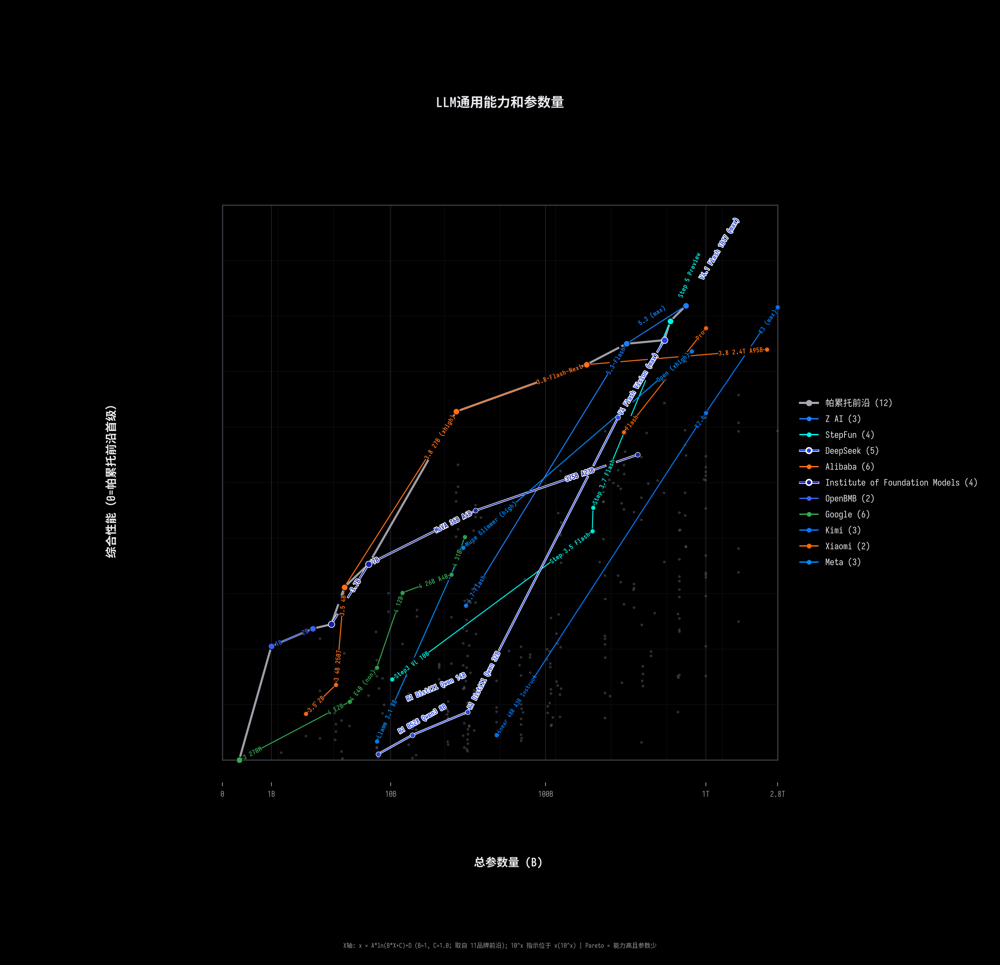

# LLM Leaderboard — 综合能力 vs 模型参数量



## 参数模型（综合能力从高到低）

共收录 **Status: All**（含已弃用）有参数量数据的模型；按重新归一化后的综合能力排序。「帕累托」项：✅ = 总体帕累托前沿模型，❌ = 被支配。图表纵轴以总体帕累托前沿第一级（y0 = 0.1250，即前沿左端点 Gemma 3 270M）为 0：综合能力 ≥ 该级的有参数量数据模型 294 个入图，52 个能力低于第一级的不出现在图中；总参数量高于品牌前沿最大值的模型同样不入图（缺少参数量数据的模型不在图表和表格中）。

| # | 模型 | 综合能力 | 总参数量 | 活跃参数量 | 大小类 | 开源 | 推理 |
|---|------|---------|---------|-----------|--------|------|------|
| 1 | Kimi K3.1 Pro | 0.9327 | 2.8T | — | large | ❌ | ✅ |
| 2 | GLM-5.3 (max) | 0.8424 | 753B | 40B | large | ✅ | ✅ |
| 3 | Kimi K3 (max) | 0.8420 | 2.8T | 104B | large | ✅ | ✅ |
| 4 | Step 5 Preview | 0.8179 | 600B | — | large | ✅ | ✅ |
| 5 | MiMo-V2.6-Pro | 0.8061 | 1T | 42B | large | ✅ | ✅ |
| 6 | DeepSeek V4.1 Flash 1017 (max) | 0.7873 | 552B | 16B | large | ✅ | ✅ |
| 7 | GLM-5.3-Flash | 0.7824 | 320B | 18B | large | ✅ | ✅ |
| 8 | Qwen3.8 2.4T A95B | 0.7749 | 2.4T | 95B | large | ✅ | ✅ |
| 9 | Muse Spark Open (xhigh) | 0.7719 | 816B | 42B | large | ✅ | ✅ |
| 10 | GLM-5.2 (max) | 0.7564 | 753B | 40B | large | ✅ | ✅ |
| 11 | Qwen3.8-Flash-Next | 0.7499 | 180B | 6B | large | ✅ | ✅ |
| 12 | Ling 3.1 Flash | 0.7241 | 560B | — | large | ✅ | ✅ |
| 13 | DeepSeek V4 Pro 0813 (max) | 0.7021 | 1.6T | 49B | large | ✅ | ✅ |
| 14 | DeepSeek V4.1 Flash (max) | 0.6884 | 552B | 16B | large | ✅ | ✅ |
| 15 | Motif 3 | 0.6803 | 314B | 13.2B | large | ✅ | ✅ |
| 16 | Qwen3.8 27B (xhigh) | 0.6767 | 27B | — | small | ✅ | ✅ |
| 17 | Kimi K2.6 | 0.6752 | 1T | 32B | large | ✅ | ✅ |
| 18 | DeepSeek V4 Flash Vision (max) | 0.6669 | 284B | — | large | ❌ | ✅ |
| 19 | DeepSeek V4 Flash 0731 (max) | 0.6663 | 284B | 13B | large | ✅ | ✅ |
| 20 | Mistral Large 4 Preview | 0.6656 | 1T | — | large | ❌ | ✅ |
| 21 | DeepSeek V4 Pro (high) | 0.6590 | 1.6T | 49B | large | ✅ | ✅ |
| 22 | GLM-5 | 0.6475 | 744B | 40B | large | ✅ | ✅ |
| 23 | JT-4.1 Flash 236B A21B | 0.6456 | 236B | — | large | ❌ | ✅ |
| 24 | Kimi K3 (low) | 0.6456 | 2.8T | 104B | large | ✅ | ✅ |
| 25 | DeepSeek V4 Pro (max) | 0.6451 | 1.6T | 49B | large | ✅ | ✅ |
| 26 | MiniMax-M3 | 0.6429 | 428B | 23B | large | ✅ | ✅ |
| 27 | MiMo-V2.6-Flash | 0.6424 | 309B | 15B | large | ✅ | ✅ |
| 28 | GLM-5.1 | 0.6240 | 744B | 40B | large | ✅ | ✅ |
| 29 | Motif 3 (Beta) | 0.6133 | 314B | — | large | ❌ | ✅ |
| 30 | K2 Horizon 375B A23B | 0.6086 | 375B | 23B | large | ✅ | ✅ |
| 31 | Kimi K2.7 Code | 0.6063 | 1T | 32B | large | ✅ | ✅ |
| 32 | Nex-N2-Pro | 0.6050 | 397B | 17B | large | ✅ | ✅ |
| 33 | GLM-5.3 (low) | 0.6044 | 753B | 40B | large | ✅ | ✅ |
| 34 | Qwen3.5 27B | 0.5927 | 27.8B | — | small | ✅ | ✅ |
| 35 | MiMo-V2-Flash (Feb 2026) | 0.5922 | 309B | 15B | large | ✅ | ✅ |
| 36 | MiMo-V2.5-Pro | 0.5890 | 1T | 42B | large | ✅ | ✅ |
| 37 | DeepSeek V4 Flash (max) | 0.5840 | 284B | 13B | large | ✅ | ✅ |
| 38 | Ling-3.0-flash-VL | 0.5828 | 124B | 5.5B | medium | ✅ | ✅ |
| 39 | Kimi K2.5 | 0.5813 | 1T | 32B | large | ✅ | ✅ |
| 40 | MiMo-V2.5 | 0.5779 | 310B | 15B | large | ✅ | ✅ |
| 41 | Kimi K2 Thinking | 0.5754 | 1T | 32B | large | ✅ | ✅ |
| 42 | Inkling (xhigh) | 0.5694 | 975B | 41B | large | ✅ | ✅ |
| 43 | Solar Open2 250B | 0.5685 | 250B | 15B | large | ✅ | ✅ |
| 44 | Kimi K2.6 (non-reasoning) | 0.5683 | 1T | 32B | large | ✅ | ❌ |
| 45 | Beam 1.0 | 0.5675 | 501B | 23B | large | ✅ | ✅ |
| 46 | Inkling Small | 0.5638 | 266B | 12B | large | ✅ | ✅ |
| 47 | Quasar 438B (max) | 0.5631 | 438B | — | large | ❌ | ✅ |
| 48 | DeepSeek V4 Flash (high) | 0.5592 | 284B | 13B | large | ✅ | ✅ |
| 49 | Qwen3.6 27B | 0.5581 | 27.8B | — | small | ✅ | ✅ |
| 50 | JT-4.1 Flash 236B A21B (non-reasoning) | 0.5580 | 236B | — | large | ❌ | ❌ |
| 51 | Hy3-preview | 0.5546 | 295B | 21B | large | ✅ | ✅ |
| 52 | MiniMax-M2.5 | 0.5494 | 230B | 10B | large | ✅ | ✅ |
| 53 | Qwen3.8 27B (medium) | 0.5484 | 27B | — | small | ✅ | ✅ |
| 54 | GLM-5.1 (non-reasoning) | 0.5483 | 744B | 40B | large | ✅ | ❌ |
| 55 | Nemotron 3 Ultra | 0.5483 | 550B | 55B | large | ✅ | ✅ |
| 56 | Qwen3.5 397B A17B | 0.5407 | 397B | 17B | large | ✅ | ✅ |
| 57 | Qwen3.8 27B (low) | 0.5347 | 27B | — | small | ✅ | ✅ |
| 58 | MiniMax-M2.1 | 0.5342 | 230B | 10B | large | ✅ | ✅ |
| 59 | MiniMax-M2.7 | 0.5340 | 230B | 10B | large | ✅ | ✅ |
| 60 | Hy3 | 0.5314 | 299B | 21B | large | ✅ | ✅ |
| 61 | Qwen3.5 35B A3B | 0.5288 | 36B | 3B | small | ✅ | ✅ |
| 62 | Step 3.7 Flash | 0.5248 | 198B | 11B | large | ✅ | ✅ |
| 63 | Kimi K2.5 (non-reasoning) | 0.5234 | 1T | 32B | large | ✅ | ❌ |
| 64 | MiMo-V2-Flash | 0.5220 | 309B | 15B | large | ✅ | ✅ |
| 65 | K2 Horizon MoVA 36B A4B | 0.5202 | 36B | 4B | small | ✅ | ✅ |
| 66 | GLM-4.7 | 0.5176 | 357B | 32B | large | ✅ | ✅ |
| 67 | DeepSeek V3.2 | 0.5168 | 685B | 37B | large | ✅ | ✅ |
| 68 | Nemotron 3.5 Super VL | 0.5162 | 120B | 12B | medium | ✅ | ✅ |
| 69 | GLM-5 (non-reasoning) | 0.5123 | 744B | 40B | large | ✅ | ❌ |
| 70 | Qwen3.6 35B A3B | 0.5102 | 36B | 3B | small | ✅ | ✅ |
| 71 | G9v3-39A5B | 0.5089 | 39B | 5B | small | ✅ | ✅ |
| 72 | Qwen3.5 397B A17B (non-reasoning) | 0.5055 | 397B | 17B | large | ✅ | ❌ |
| 73 | Qwen3.5 122B A10B | 0.5014 | 125B | 10B | medium | ✅ | ✅ |
| 74 | Qwen3.5 27B (non-reasoning) | 0.4906 | 27.8B | — | small | ✅ | ❌ |
| 75 | A.X-K2 | 0.4893 | 692B | 33B | large | ✅ | ✅ |
| 76 | DeepSeek V3.2 Speciale | 0.4889 | 685B | 37B | large | ✅ | ✅ |
| 77 | JT-35B-Flash | 0.4884 | 35B | — | small | ❌ | ❌ |
| 78 | Step 3.5 Flash | 0.4874 | 196B | 11B | large | ✅ | ✅ |
| 79 | Ling-3.0-flash-Fin | 0.4854 | 124B | 5.1B | medium | ✅ | ✅ |
| 80 | Ling 3.0 Flash | 0.4812 | 124B | 5.1B | medium | ✅ | ✅ |
| 81 | Qwen3.8 27B (non-reasoning) | 0.4790 | 27B | — | small | ✅ | ❌ |
| 82 | Gemma 4 31B | 0.4782 | 30.7B | — | small | ✅ | ✅ |
| 83 | MiniMax-M2 | 0.4749 | 230B | 10B | large | ✅ | ✅ |
| 84 | Solar Mini 4 | 0.4699 | 35B | — | small | ❌ | ✅ |
| 85 | K-EXAONE 2.0 | 0.4633 | 750B | 37B | large | ✅ | ✅ |
| 86 | GLM-5.2 (non-reasoning) | 0.4626 | 753B | 40B | large | ✅ | ❌ |
| 87 | Muse Glimmer (high) | 0.4613 | 30B | — | small | ✅ | ✅ |
| 88 | DeepSeek V4 Pro (non-reasoning) | 0.4600 | 1.6T | 49B | large | ✅ | ❌ |
| 89 | Qwen3.6 27B (non-reasoning) | 0.4573 | 27.8B | — | small | ✅ | ❌ |
| 90 | Mistral Medium 3.5 | 0.4504 | 128B | — | medium | ✅ | ✅ |
| 91 | Ring-2.6-1T | 0.4490 | 1T | 63B | large | ✅ | ✅ |
| 92 | DeepSeek V3.2 Exp | 0.4429 | 685B | 37B | large | ✅ | ✅ |
| 93 | Command A+ | 0.4386 | 218B | 25B | large | ✅ | ✅ |
| 94 | DeepSeek V4.1 Flash (non-reasoning) | 0.4385 | 552B | 16B | large | ✅ | ❌ |
| 95 | Qwen3.5 122B A10B (non-reasoning) | 0.4374 | 125B | 10B | medium | ✅ | ❌ |
| 96 | K2 Horizon 7B | 0.4347 | 7B | — | small | ✅ | ✅ |
| 97 | LongCat 2.0 | 0.4223 | 1.6T | 48B | large | ✅ | ✅ |
| 98 | MiMo-V2.5-Pro (non-reasoning) | 0.4213 | 1T | 42B | large | ✅ | ❌ |
| 99 | Gemma 4 26B A4B | 0.4189 | 25.2B | 3.8B | small | ✅ | ✅ |
| 100 | Kimi K2 0905 | 0.4185 | 1T | 32B | large | ✅ | ❌ |
| 101 | DeepSeek V4 Flash (non-reasoning) | 0.4172 | 284B | 13B | large | ✅ | ❌ |
| 102 | Qwen3 VL 235B A22B | 0.4171 | 235B | 22B | large | ✅ | ✅ |
| 103 | DeepSeek V3.1 Terminus | 0.4156 | 685B | 37B | large | ✅ | ✅ |
| 104 | Ling-2.6-1T | 0.4143 | 1T | 63B | large | ✅ | ❌ |
| 105 | Nemotron 3.5 Bolt 74B-A9B | 0.4112 | 74B | 9B | medium | ✅ | ✅ |
| 106 | DeepSeek V3.2 (non-reasoning) | 0.4085 | 685B | 37B | large | ✅ | ❌ |
| 107 | Hy3-preview (non-reasoning) | 0.4067 | 295B | 21B | large | ✅ | ❌ |
| 108 | GLM-4.7 (non-reasoning) | 0.4037 | 357B | 32B | large | ✅ | ❌ |
| 109 | Qwen3.6 35B A3B (non-reasoning) | 0.4024 | 36B | 3B | small | ✅ | ❌ |
| 110 | Qwen3.5 4B | 0.3987 | 4.66B | — | small | ✅ | ✅ |
| 111 | GLM-4.6 | 0.3973 | 357B | 32B | large | ✅ | ✅ |
| 112 | EXAONE 4.5 33B | 0.3953 | 34.4B | — | small | ✅ | ✅ |
| 113 | DeepSeek V3.1 | 0.3950 | 685B | 37B | large | ✅ | ✅ |
| 114 | GLM-4.5 | 0.3944 | 355B | 32B | large | ✅ | ✅ |
| 115 | Gemma 4 12B | 0.3900 | 12B | — | small | ✅ | ✅ |
| 116 | Qwen3.5 9B | 0.3893 | 9.65B | — | small | ✅ | ✅ |
| 117 | Kimi K2 | 0.3848 | 1T | 32B | large | ✅ | ❌ |
| 118 | DeepSeek R1 0528 | 0.3833 | 685B | 37B | large | ✅ | ✅ |
| 119 | K-EXAONE | 0.3800 | 236B | 23B | large | ✅ | ✅ |
| 120 | Gemma 4 31B (non-reasoning) | 0.3770 | 30.7B | — | small | ✅ | ❌ |
| 121 | Qwen3.5 35B A3B (non-reasoning) | 0.3743 | 36B | 3B | small | ✅ | ❌ |
| 122 | Qwen3 VL 32B | 0.3741 | 33.4B | — | small | ✅ | ✅ |
| 123 | MiMo-V2-Flash (non-reasoning) | 0.3716 | 309B | 15B | large | ✅ | ❌ |
| 124 | GLM-4.7-Flash | 0.3700 | 31.2B | 3B | small | ✅ | ✅ |
| 125 | GLM-4.6 (non-reasoning) | 0.3664 | 357B | 32B | large | ✅ | ❌ |
| 126 | Apriel-v1.5-15B-Thinker | 0.3625 | 15B | — | small | ✅ | ✅ |
| 127 | Qwen3.5 9B (non-reasoning) | 0.3599 | 9.65B | — | small | ✅ | ❌ |
| 128 | Qwen3 Coder 480B | 0.3576 | 480B | 35B | large | ✅ | ❌ |
| 129 | Cogito v2.1 | 0.3563 | 671B | 37B | large | ✅ | ✅ |
| 130 | Nemotron 3 Super | 0.3556 | 120.6B | 12.7B | medium | ✅ | ✅ |
| 131 | Apriel-v1.6-15B-Thinker | 0.3523 | 15B | — | small | ✅ | ✅ |
| 132 | Gemma 4 26B A4B (non-reasoning) | 0.3512 | 25.2B | 3.8B | small | ✅ | ❌ |
| 133 | GLM-4.6V | 0.3499 | 108B | 12B | medium | ✅ | ✅ |
| 134 | DeepSeek V3.1 Terminus (non-reasoning) | 0.3492 | 685B | 37B | large | ✅ | ❌ |
| 135 | Nemotron Cascade 2 30B A3B | 0.3466 | 31.6B | 3B | small | ✅ | ✅ |
| 136 | DeepSeek V4 Pro 0813 (non-reasoning) | 0.3439 | 1.6T | 49B | large | ✅ | ❌ |
| 137 | K2 Horizon 3.7B | 0.3399 | 3.7B | — | tiny | ✅ | ✅ |
| 138 | Trinity Large Thinking | 0.3390 | 399B | 13B | large | ✅ | ✅ |
| 139 | Granite 4.2 30B | 0.3333 | 30B | — | small | ✅ | ✅ |
| 140 | MiniCPM5-2B | 0.3330 | 2.6B | — | tiny | ✅ | ✅ |
| 141 | DeepSeek V3.2 Exp (non-reasoning) | 0.3315 | 685B | 37B | large | ✅ | ❌ |
| 142 | Nemotron 3.5 Lightning | 0.3296 | 31.6B | 3.6B | small | ✅ | ✅ |
| 143 | DeepSeek V3.1 (non-reasoning) | 0.3284 | 685B | 37B | large | ✅ | ❌ |
| 144 | Ling 3.0 Tiny | 0.3282 | 7.9B | 1.3B | small | ✅ | ✅ |
| 145 | gpt-oss-120b (high) | 0.3252 | 117B | 5.1B | medium | ✅ | ✅ |
| 146 | Seed-OSS-36B-Instruct | 0.3245 | 36.2B | — | small | ✅ | ✅ |
| 147 | Qwen3 235B A22B 2507 | 0.3217 | 235B | 22B | large | ✅ | ✅ |
| 148 | G9v3-3B | 0.3174 | 3B | — | tiny | ✅ | ✅ |
| 149 | Qwen3 235B 2507 | 0.3171 | 235B | 22B | large | ✅ | ❌ |
| 150 | North Mini Code | 0.3097 | 30B | 3B | small | ✅ | ✅ |
| 151 | Mistral Small 4 | 0.3093 | 119B | 6.5B | medium | ✅ | ✅ |
| 152 | Gemma 4 12B (non-reasoning) | 0.3087 | 12B | — | small | ✅ | ❌ |
| 153 | Qwen3 VL 235B A22B | 0.3081 | 235B | — | large | ✅ | ❌ |
| 154 | QwQ-32B | 0.3062 | 32.8B | — | small | ✅ | ✅ |
| 155 | Ring-1T | 0.3051 | 1T | 50B | large | ✅ | ✅ |
| 156 | MiniCPM5-1B | 0.3051 | 1B | — | tiny | ✅ | ✅ |
| 157 | MiniCPM5-1B (non-reasoning) | 0.3050 | 1B | — | tiny | ✅ | ❌ |
| 158 | K2 Think V2 | 0.3043 | 70B | — | medium | ✅ | ✅ |
| 159 | Pixtral Large | 0.3038 | 124B | — | medium | ✅ | ❌ |
| 160 | Solar Open 100B | 0.3004 | 102B | 12B | medium | ✅ | ✅ |
| 161 | HyperNova 60B 2605 (high) | 0.2975 | 58.7B | 4.8B | medium | ✅ | ✅ |
| 162 | GLM-4.5-Air | 0.2969 | 106B | 12B | medium | ✅ | ✅ |
| 163 | MiniMax M1 80k | 0.2968 | 456B | 45.9B | large | ✅ | ✅ |
| 164 | Qwen3.5 4B (non-reasoning) | 0.2939 | 4.66B | — | small | ✅ | ❌ |
| 165 | Qwen3 Next 80B A3B | 0.2920 | 80B | 3B | medium | ✅ | ✅ |
| 166 | MiniMax M1 40k | 0.2899 | 456B | 45.9B | large | ✅ | ✅ |
| 167 | HyperCLOVA X SEED Think (32B) | 0.2897 | 32B | — | small | ✅ | ✅ |
| 168 | K2-V2 (high) | 0.2875 | 70B | — | medium | ✅ | ✅ |
| 169 | Qwen3 Coder Next | 0.2874 | 79.7B | 3B | medium | ✅ | ❌ |
| 170 | K-EXAONE (non-reasoning) | 0.2873 | 236B | 23B | large | ✅ | ❌ |
| 171 | Solar Pro 3 | 0.2841 | 102B | — | medium | ❌ | ✅ |
| 172 | Granite 4.2 8B | 0.2831 | 8B | — | small | ✅ | ✅ |
| 173 | INTELLECT-3 | 0.2777 | 107B | 12B | medium | ✅ | ✅ |
| 174 | DiffusionGemma 26B A4B | 0.2776 | 25.2B | 3.8B | small | ✅ | ✅ |
| 175 | Tri-21B-think Preview | 0.2769 | 21B | — | small | ✅ | ✅ |
| 176 | LongCat Flash Lite | 0.2753 | 68.5B | 3B | medium | ✅ | ❌ |
| 177 | Qwen3 VL 30B A3B | 0.2749 | 30B | 3B | small | ✅ | ✅ |
| 178 | gpt-oss-20b (low) | 0.2745 | 21B | 3.6B | small | ✅ | ✅ |
| 179 | Llama 3.1 405B | 0.2734 | 405B | — | large | ✅ | ❌ |
| 180 | Ling 2.6 Flash | 0.2721 | 107B | 7.4B | medium | ✅ | ❌ |
| 181 | Nemotron 3 Nano | 0.2715 | 31.6B | 3.6B | small | ✅ | ✅ |
| 182 | Gemma 4 E4B (non-reasoning) | 0.2714 | 8B | 4.5B | small | ✅ | ❌ |
| 183 | Tri-21B-Think | 0.2712 | 21B | — | small | ✅ | ✅ |
| 184 | Qwen3 Next 80B A3B | 0.2633 | 80B | 3B | medium | ✅ | ❌ |
| 185 | Qwen3 VL 32B | 0.2630 | 33.4B | — | small | ✅ | ❌ |
| 186 | Nemotron 3 Nano Omni 30B A3B | 0.2616 | 30B | 3B | small | ✅ | ✅ |
| 187 | Hermes 4 405B | 0.2613 | 406B | — | large | ✅ | ✅ |
| 188 | DeepSeek R1 (Jan) | 0.2596 | 685B | 37B | large | ✅ | ✅ |
| 189 | K2-V2 (medium) | 0.2588 | 70B | — | medium | ✅ | ✅ |
| 190 | Ling-1T | 0.2579 | 1T | 50B | large | ✅ | ❌ |
| 191 | DeepSeek V3 0324 | 0.2578 | 671B | 37B | large | ✅ | ❌ |
| 192 | Gemma 4 E4B | 0.2577 | 8B | 4.5B | small | ✅ | ✅ |
| 193 | Motif-2-12.7B | 0.2574 | 12.7B | — | small | ❌ | ✅ |
| 194 | Mistral Large 3 | 0.2553 | 675B | 41B | large | ✅ | ❌ |
| 195 | Qwen3 VL 8B | 0.2543 | 8.77B | — | small | ✅ | ✅ |
| 196 | gpt-oss-20b (high) | 0.2527 | 21B | 3.6B | small | ✅ | ✅ |
| 197 | Step3 VL 10B | 0.2526 | 10.2B | — | small | ✅ | ✅ |
| 198 | Llama Nemotron Super 49B v1.5 | 0.2504 | 49B | — | medium | ✅ | ✅ |
| 199 | Llama 4 Maverick | 0.2503 | 402B | 17B | large | ✅ | ❌ |
| 200 | GLM-4.7-Flash (non-reasoning) | 0.2500 | 31.2B | 3B | small | ✅ | ❌ |
| 201 | gpt-oss-120b (low) | 0.2492 | 117B | 5.1B | medium | ✅ | ✅ |
| 202 | ERNIE 4.5 300B A47B | 0.2473 | 300B | 47B | large | ✅ | ❌ |
| 203 | Qwen3 4B 2507 | 0.2442 | 4.02B | — | tiny | ✅ | ✅ |
| 204 | Mistral Small 4 (non-reasoning) | 0.2430 | 119B | 6.5B | medium | ✅ | ❌ |
| 205 | Hermes 4 405B (non-reasoning) | 0.2419 | 406B | — | large | ✅ | ❌ |
| 206 | Qwen3 Coder 30B A3B | 0.2407 | 30.5B | 3.3B | small | ✅ | ❌ |
| 207 | Qwen3 30B A3B 2507 | 0.2385 | 30.5B | 3.3B | small | ✅ | ✅ |
| 208 | LFM2.5-8B-A1B | 0.2383 | 8.3B | 1.5B | small | ✅ | ✅ |
| 209 | Devstral 2 | 0.2380 | 125B | — | medium | ✅ | ❌ |
| 210 | Qwen3 VL 30B A3B | 0.2375 | 30B | 3B | small | ✅ | ❌ |
| 211 | GLM-4.6V (non-reasoning) | 0.2369 | 108B | 12B | medium | ✅ | ❌ |
| 212 | Qwen3 Omni 30B A3B | 0.2351 | 35.3B | 3B | small | ✅ | ✅ |
| 213 | Granite 4.2 3B | 0.2345 | 3B | — | tiny | ✅ | ✅ |
| 214 | Qwen3 235B | 0.2310 | 235B | 22B | large | ✅ | ✅ |
| 215 | GLM-4.5V | 0.2302 | 108B | 12B | medium | ✅ | ✅ |
| 216 | NVIDIA Nemotron Nano 12B v2 VL | 0.2295 | 13.2B | — | small | ✅ | ✅ |
| 217 | Mistral Large 2 (Nov) | 0.2285 | 123B | — | medium | ✅ | ❌ |
| 218 | Falcon-H1R-7B | 0.2271 | 7B | — | small | ✅ | ✅ |
| 219 | Llama Nemotron Ultra | 0.2261 | 253B | — | large | ✅ | ✅ |
| 220 | Devstral Small 2 | 0.2175 | 24B | — | small | ✅ | ❌ |
| 221 | Gemma 4 E2B | 0.2172 | 5.1B | 2.3B | small | ✅ | ✅ |
| 222 | LFM2.5-2.6B | 0.2164 | 2.7B | — | tiny | ✅ | ✅ |
| 223 | Olmo 3.1 32B Think | 0.2163 | 32.2B | — | small | ✅ | ✅ |
| 224 | Sarvam 105B (high) | 0.2154 | 106B | 10.3B | medium | ✅ | ✅ |
| 225 | EXAONE 4.0 32B | 0.2144 | 32B | — | small | ✅ | ✅ |
| 226 | K2-V2 (low) | 0.2129 | 70B | — | medium | ✅ | ✅ |
| 227 | NVIDIA Nemotron Nano 9B V2 | 0.2124 | 9B | — | small | ✅ | ✅ |
| 228 | Ring-flash-2.0 | 0.2099 | 103B | 6.1B | medium | ✅ | ✅ |
| 229 | Llama Nemotron Super 49B v1.5 (non-reasoning) | 0.2082 | 49B | — | medium | ✅ | ❌ |
| 230 | Hermes 4 70B | 0.2062 | 70.6B | — | medium | ✅ | ✅ |
| 231 | Devstral Small (May) | 0.2051 | 23.6B | — | small | ✅ | ❌ |
| 232 | Magistral Small 1.2 | 0.2016 | 24B | — | small | ✅ | ✅ |
| 233 | Llama 3.3 Nemotron Super 49B | 0.2015 | 49B | — | medium | ✅ | ✅ |
| 234 | DeepSeek R1 Distill Qwen 32B | 0.2011 | 32B | — | small | ✅ | ✅ |
| 235 | DeepSeek V3 (Dec) | 0.2009 | 671B | 37B | large | ✅ | ❌ |
| 236 | Qwen2.5 72B | 0.2004 | 72B | — | medium | ✅ | ❌ |
| 237 | Ling-flash-2.0 | 0.1996 | 103B | 6.1B | medium | ✅ | ❌ |
| 238 | Nanbeige4.1-3B | 0.1993 | 3.93B | — | tiny | ✅ | ✅ |
| 239 | Qwen3 VL 8B | 0.1990 | 8.77B | — | small | ✅ | ❌ |
| 240 | Qwen3.5 2B | 0.1981 | 2.27B | — | tiny | ✅ | ✅ |
| 241 | Qwen3 30B | 0.1975 | 30.5B | 3.3B | small | ✅ | ✅ |
| 242 | Magistral Small 1 | 0.1971 | 23.6B | — | small | ✅ | ✅ |
| 243 | Mistral Large 2 (Jul) | 0.1932 | 123B | — | medium | ✅ | ❌ |
| 244 | Command A | 0.1923 | 111B | — | medium | ✅ | ❌ |
| 245 | Devstral Small | 0.1917 | 24B | — | small | ✅ | ❌ |
| 246 | Qwen3 235B (non-reasoning) | 0.1914 | 235B | 22B | large | ✅ | ❌ |
| 247 | Mistral Small 3.2 | 0.1901 | 24B | — | small | ✅ | ❌ |
| 248 | Llama 3.1 Nemotron 70B | 0.1901 | 70B | — | medium | ✅ | ❌ |
| 249 | Qwen3 VL 4B | 0.1875 | 4.44B | — | tiny | ✅ | ✅ |
| 250 | Llama 3.3 Nemotron Super 49B (non-reasoning) | 0.1849 | 49B | — | medium | ✅ | ❌ |
| 251 | Qwen3 30B A3B 2507 (non-reasoning) | 0.1831 | 30.5B | 3.3B | small | ✅ | ❌ |
| 252 | Qwen3 4B | 0.1817 | 4.02B | — | tiny | ✅ | ✅ |
| 253 | Llama 3.1 70B | 0.1812 | 70B | — | medium | ✅ | ❌ |
| 254 | NVIDIA Nemotron Nano 9B V2 (non-reasoning) | 0.1809 | 9B | — | small | ✅ | ❌ |
| 255 | Llama 4 Scout | 0.1807 | 109B | 17B | medium | ✅ | ❌ |
| 256 | Qwen3 32B (non-reasoning) | 0.1794 | 32.8B | — | small | ✅ | ❌ |
| 257 | GLM-4.5V (non-reasoning) | 0.1790 | 108B | 12B | medium | ✅ | ❌ |
| 258 | Gemma 4 E2B (non-reasoning) | 0.1789 | 5.1B | 2.3B | small | ✅ | ❌ |
| 259 | Qwen3 32B | 0.1782 | 32.8B | — | small | ✅ | ✅ |
| 260 | Ministral 3 14B | 0.1740 | 14B | — | small | ✅ | ❌ |
| 261 | Olmo 3.1 32B Instruct | 0.1735 | 32.2B | — | small | ✅ | ❌ |
| 262 | Qwen3 14B | 0.1731 | 14.8B | — | small | ✅ | ✅ |
| 263 | Qwen3 Omni 30B A3B | 0.1718 | 35.3B | 3B | small | ✅ | ❌ |
| 264 | Qwen3 4B 2507 (non-reasoning) | 0.1700 | 4.02B | — | tiny | ✅ | ❌ |
| 265 | Olmo 3 32B Think | 0.1658 | 32.2B | — | small | ✅ | ✅ |
| 266 | DeepSeek R1 Distill Llama 70B | 0.1650 | 70B | — | medium | ✅ | ✅ |
| 267 | DeepSeek R1 Distill Qwen 14B | 0.1646 | 14B | — | small | ✅ | ✅ |
| 268 | Kimi Linear 48B A3B Instruct | 0.1643 | 49.1B | 3B | medium | ✅ | ❌ |
| 269 | Granite 4.1 30B | 0.1636 | 30B | — | small | ✅ | ❌ |
| 270 | Qwen3.5 2B (non-reasoning) | 0.1627 | 2.27B | — | tiny | ✅ | ❌ |
| 271 | Hermes 4 70B (non-reasoning) | 0.1597 | 70.6B | — | medium | ✅ | ❌ |
| 272 | Jamba Reasoning 3B | 0.1594 | 3B | — | tiny | ✅ | ✅ |
| 273 | EXAONE 4.0 32B (non-reasoning) | 0.1572 | 32B | — | small | ✅ | ❌ |
| 274 | Nemotron 3 Nano 4B | 0.1569 | 3.97B | — | tiny | ✅ | ✅ |
| 275 | Llama 3.3 70B | 0.1555 | 70B | — | medium | ✅ | ❌ |
| 276 | Llama 3.1 8B | 0.1547 | 8B | — | small | ✅ | ❌ |
| 277 | LFM2 24B A2B | 0.1539 | 23.8B | 2.3B | small | ✅ | ❌ |
| 278 | Jamba 1.7 Large | 0.1528 | 398B | 94B | large | ✅ | ❌ |
| 279 | Sarvam 30B (high) | 0.1509 | 32.2B | 2.4B | small | ✅ | ✅ |
| 280 | Mistral Small 3 | 0.1495 | 24B | — | small | ✅ | ❌ |
| 281 | NVIDIA Nemotron Nano 12B v2 VL (non-reasoning) | 0.1492 | 13.2B | — | small | ✅ | ❌ |
| 282 | Granite 4.1 8B | 0.1454 | 8B | — | small | ✅ | ❌ |
| 283 | Qwen3 30B (non-reasoning) | 0.1447 | 30.5B | 3.3B | small | ✅ | ❌ |
| 284 | Ministral 3 8B | 0.1438 | 8B | — | small | ✅ | ❌ |
| 285 | Nemotron 3 Nano (non-reasoning) | 0.1420 | 31.6B | 3.6B | small | ✅ | ❌ |
| 286 | Granite 4.0 H Small | 0.1388 | 32B | 9B | small | ✅ | ❌ |
| 287 | Qwen3 VL 4B | 0.1384 | 4.44B | — | tiny | ✅ | ❌ |
| 288 | MiniCPM-V 4.6 1.3B | 0.1365 | 1.3B | — | tiny | ✅ | ❌ |
| 289 | DeepSeek R1 0528 Qwen3 8B | 0.1344 | 8.19B | — | small | ✅ | ✅ |
| 290 | Qwen3 14B (non-reasoning) | 0.1326 | 14.8B | — | small | ✅ | ❌ |
| 291 | Qwen3 8B | 0.1289 | 8.19B | — | small | ✅ | ✅ |
| 292 | Phi-4 | 0.1280 | 14B | — | small | ✅ | ❌ |
| 293 | Llama 3.1 Nemotron Nano 4B v1.1 | 0.1272 | 4.51B | — | small | ✅ | ✅ |
| 294 | Gemma 3 270M | 0.1250 | 0.268B | — | tiny | ✅ | ❌ |
| 295 | Gemma 3 27B | 0.1206 | 27.4B | — | small | ✅ | ❌ |
| 296 | Llama 3 70B | 0.1199 | 70B | — | medium | ✅ | ❌ |
| 297 | Llama 3.2 11B (Vision) | 0.1194 | 11B | — | small | ✅ | ❌ |
| 298 | Llama 3.2 3B | 0.1175 | 3B | — | tiny | ✅ | ❌ |
| 299 | Olmo 3 7B Think | 0.1160 | 7B | — | small | ✅ | ✅ |
| 300 | Ministral 3 3B | 0.1143 | 3B | — | tiny | ✅ | ❌ |
| 301 | LFM2.5-1.2B-Instruct | 0.1094 | 1.17B | — | tiny | ✅ | ❌ |
| 302 | Reka Flash 3 | 0.1089 | 21B | — | small | ✅ | ✅ |
| 303 | Ling-mini-2.0 | 0.1084 | 16.3B | 1.4B | small | ✅ | ❌ |
| 304 | LFM2 2.6B | 0.1084 | 2.57B | — | tiny | ✅ | ❌ |
| 305 | Qwen3 8B (non-reasoning) | 0.1074 | 8.19B | — | small | ✅ | ❌ |
| 306 | Qwen3.5 0.8B | 0.1064 | 0.873B | — | tiny | ✅ | ✅ |
| 307 | Molmo2-8B | 0.1041 | 8.66B | — | small | ✅ | ❌ |
| 308 | Sarvam M | 0.1039 | 23.6B | — | small | ✅ | ✅ |
| 309 | Jamba 1.7 Mini | 0.1026 | 52B | 12B | medium | ✅ | ❌ |
| 310 | LFM2.5-1.2B-Thinking | 0.1012 | 1.17B | — | tiny | ✅ | ✅ |
| 311 | Apertus 70B Instruct | 0.0943 | 70B | — | medium | ✅ | ❌ |
| 312 | Olmo 3 7B | 0.0929 | 7B | — | small | ✅ | ❌ |
| 313 | Exaone 4.0 1.2B | 0.0919 | 1.28B | — | tiny | ✅ | ✅ |
| 314 | OLMo 2 32B | 0.0918 | 32.2B | — | small | ✅ | ❌ |
| 315 | Granite 4.0 H 1B | 0.0913 | 1.5B | — | tiny | ✅ | ❌ |
| 316 | Llama 3.2 1B | 0.0902 | 1B | — | tiny | ✅ | ❌ |
| 317 | Phi-4 Mini | 0.0896 | 3.84B | — | tiny | ✅ | ❌ |
| 318 | Qwen3 1.7B | 0.0891 | 2.03B | — | tiny | ✅ | ✅ |
| 319 | Qwen3.5 0.8B (non-reasoning) | 0.0858 | 0.873B | — | tiny | ✅ | ❌ |
| 320 | Exaone 4.0 1.2B (non-reasoning) | 0.0849 | 1.28B | — | tiny | ✅ | ❌ |
| 321 | Gemma 3 12B | 0.0841 | 12.2B | — | small | ✅ | ❌ |
| 322 | LFM2 8B A1B | 0.0831 | 8.34B | 1.5B | small | ✅ | ❌ |
| 323 | Granite 4.0 Micro | 0.0804 | 3B | — | tiny | ✅ | ❌ |
| 324 | Granite 4.1 3B | 0.0798 | 3B | — | tiny | ✅ | ❌ |
| 325 | Phi-3 Mini | 0.0755 | 3.8B | — | tiny | ✅ | ❌ |
| 326 | Granite 3.3 8B (non-reasoning) | 0.0721 | 8.17B | — | small | ✅ | ❌ |
| 327 | LFM2.5-VL-1.6B | 0.0695 | 1.6B | — | tiny | ✅ | ❌ |
| 328 | Granite 4.0 1B | 0.0688 | 1.6B | — | tiny | ✅ | ❌ |
| 329 | Granite 4.0 350M | 0.0677 | 0.35B | — | tiny | ✅ | ❌ |
| 330 | LFM2 1.2B | 0.0659 | 1.17B | — | tiny | ✅ | ❌ |
| 331 | Qwen3 0.6B | 0.0653 | 0.752B | — | tiny | ✅ | ✅ |
| 332 | Llama 3 8B | 0.0650 | 8B | — | small | ✅ | ❌ |
| 333 | Mistral 7B | 0.0626 | 7B | — | small | ✅ | ❌ |
| 334 | Gemma 3 4B | 0.0606 | 4.3B | — | tiny | ✅ | ❌ |
| 335 | Qwen3 1.7B (non-reasoning) | 0.0571 | 2.03B | — | tiny | ✅ | ❌ |
| 336 | OLMo 2 7B | 0.0568 | 7.3B | — | small | ✅ | ❌ |
| 337 | Gemma 3 1B | 0.0565 | 1B | — | tiny | ✅ | ❌ |
| 338 | Apertus 8B Instruct | 0.0555 | 8B | — | small | ✅ | ❌ |
| 339 | Gemma 3n E4B | 0.0535 | 8.39B | 4B | small | ✅ | ❌ |
| 340 | Granite 4.0 H 350M | 0.0513 | 0.34B | — | tiny | ✅ | ❌ |
| 341 | Molmo 7B-D | 0.0481 | 8.02B | — | small | ✅ | ❌ |
| 342 | K2 Horizon 0.9B | 0.0460 | 0.9B | — | tiny | ✅ | ✅ |
| 343 | Qwen3 0.6B (non-reasoning) | 0.0441 | 0.752B | — | tiny | ✅ | ❌ |
| 344 | Gemma 3n E2B | 0.0363 | 5.98B | 2B | small | ✅ | ❌ |
| 345 | Tiny Aya Global | 0.0359 | 3.35B | — | tiny | ✅ | ❌ |
| 346 | DeepSeek R1 Distill Qwen 1.5B | 0.0000 | 1.5B | — | tiny | ✅ | ✅ |

## 品牌帕累托前沿连线（仅体现在图中）

以下 10 个品牌在图中拥有单独的帕累托连线（较窄宽度，品牌主题色，图层高于总体灰色连线）。表中数量为**入图顶点数**——品牌前沿上低于总体前沿第一级的顶点同样不入图（本表与图例一致）：

| 品牌 | 主题色 | 品牌前沿模型数（入图） |
|------|--------|--------------|
|  Kimi | `#047AFE` | 3 |
|  Z AI | `#1c7ff8` | 3 |
|  StepFun | `#00F5E7` | 4 |
|  DeepSeek | `#2243e6` | 5 |
|  Alibaba | `#ff7018` | 6 |
|  Institute of Foundation Models | `#1521a9` | 4 |
|  OpenBMB | `#3B62EC` | 2 |
|  Google | `#34A853` | 6 |
|  Xiaomi | `#ff6900` | 2 |
|  Meta | `#0089f4` | 3 |

## 评分方法

1. **20项评估指标**各自线性归一化到 [0,1]
   （AA Intelligence Index、GPQA Diamond、Humanity's Last Exam、MMMU Pro、IFBench Instruction Following、SciCode Coding、CritPt Physics、AA-LCR Long Context、AA Omniscience Index、AA-Omniscience Accuracy、AA-Omniscience Non-Hallucination、GDPval-AA Normalized、AA Analyst Agent、APEX-Agents-AA、ITBench-SRE、τ²-Bench Telecom、τ³-Bench Banking、Terminal-Bench Hard、Terminal-Bench 2.1、Terminal-Bench 4.0）
   > V18（2026-09-12）：AA 更新了基准列——新增 AA Analyst Agent、τ³-Bench Banking、Terminal-Bench 2.1 / 4.0 四项；AA Agentic Index 与 AA Coding Index 已从 AA 的数据源中移除，相应剔除。指标数由 18 → 20。
2. **综合能力值** = 所有有效归一化分数的算术平均
3. **综合能力再归一化**：线性映射到 [0,1]，性能最好的模型 = 1，最差的模型 = 0
4. **Pareto前沿** = 不被任何其他模型支配的模型（综合能力 ≥ 且总参数量 ≤，且至少一项严格更优；缺少参数量数据的模型不在图表和表格中）
5. **模型范围** = Status: All（含已弃用模型；缺少足够评估数据者不参与排名）
6. **图表纵轴基线（V17）**：图表的 y = 0 取总体帕累托前沿的第一级（最低能力；本例 y0 = 0.1250，即前沿左端点 Gemma 3 270M）；综合能力低于该级的模型不出现在图表中（表格不受影响）。图中纵坐标 chart_y = (能力 - y0)/(1 - y0)，因此前沿左端点恰好落在 (0, 0)、最优模型恰好为 y = 1。该过滤在横轴映射构建之前完成


## 横轴映射（对数）

横轴（总参数量）为 **x = A·ln(B·X+C)+D 对数映射**（B = 1；A、D 按端点定出；C = 0.98，r = B/C = 1.01632），用 11 品牌前沿入图模型的总参数量定出；mse = 0.002656，maxdev = 0.1116。

```
x = 0                            # X = 0
x = A·ln(X+C)+D                  # X > 0
```

- **函数端点**：X = 0 → x = 0；前沿最大值 → x = 1；
- 数量级入图模型数：1B–10B: 39，10B–100B: 104，100B–1T: 138，1T–2.8T: 10
- 中位数位置 0.585；左 129 个，右 165 个
- 前沿最大总参数量 2,800.0B → x = 1；高于该值的模型不入图，表格中有。
- 10^x 数量级指示（位置 = x(10^x)）：10^0→ 0.088，10^1→ 0.303，10^2→ 0.582，10^3→ 0.871

## 图中标注规则

品牌帕累托前沿模型全部标注。V13/V15/V16 规则：

1. **品牌公共前缀剔除（最长有效切点）**：品牌全部前沿模型共享的前导块被剔除 —— 切点须止于分界符（空格/连字符/下划线，如 'Claude '、'GPT-'、'GLM-'、'Grok '、'DeepSeek V4 '），或止于字母且每个名称在切点后紧跟数字（品牌/系列字母 + 版本号，如 'Kimi K|2.6'、'Qwen|3.8'、'MiMo-V|2.5'、'MiniMax-M|2.1'）—— 实例：Claude Opus 5 (high) → Opus 5 (high)、GPT-5.6 Sol → 5.6 Sol、Kimi K2.6 → 2.6、Qwen3.8 Max → 3.8 Max、MiMo-V2.5-Pro → 2.5-Pro；剔除后任一名称为空或产生重复标签则该切点作废，顺次尝试更短切点；
2. **(non-reasoning) → (non)**：思考程度中的 Non-reasoning 简写为 non（含组合式：Non-reasoning, high → non, high）；
3. **相邻同名 run 短标签（每次重新计算）**：品牌连线上连续 2 个以上顶点属于同一模型时，仅性能最低者（run 首位）保留全名，其后相邻的较高者只标思考程度（如 Opus 5 的 (low) (medium) (high) (xhigh) 序列仅首项带族名）；同名模型不相邻的重复出现不合并、保留全名 —— A-B(high)-B(xhigh)-C-B(max) 标注为 A-B(high)-(xhigh)-C-B(max)，因此交错家族（Gemini 3.7 / 3.8 Flash、Claude Fable 5.1 / Opus 5）始终可分辨。

4. **标签位置与序列同向（V15）**：品牌前沿上越靠右上的模型，其标签重心必须同时更靠右且更靠上 —— 对前沿相邻对 A→B（B 更靠右上），标签位移的两个分量须同时 >= 0（至少是 (0,0)），既不得更左、也不得更低（只要有一个分量非负不算合格；V14 的投影规则会放过「更右但更低」，V15 起视为违反；等参数堆叠即：上方模型的标签既在上方、也不更左）；初始放置违反时就近重摆（不产生新的重叠、不破坏与前后邻居的同向关系，最多 6 轮；单标签重摆无解——标签被前后邻居夹死、局部约束盒为空——时，自动升级为以违规对为中心逐级扩大的窗口级联重排，整段相邻标签作为一个阶梯整体重排，修不好的配对在日志中报告）。

5. **标签摆放四级优先（V16）**：① 尽量多的标签骑在连线段上——点的右侧（去路段）或左侧（来路段）皆可，同一条线段允许容纳两个标签（各贴各的点）；目标骑线位仅被其他标签占据时触发「让位」——占用者挪到自己的另一个骑线位，双方都保持骑线。② 骑不上线的标签在「假设线能放下该标签」的离点最近位置的上方或下方、与线平行摆放（右/左侧 × 上/下方四组合；互相掣肘的标签自然错开成对角组合）。③ 仍放不下时放在点的两条连线延长线上的最近点。④ 最后在两条连线夹角形成的扇区（连线前上方空白区）内就近放置，文字保持与邻近连线平行。

标注文字与连线平行且中轴线重合；文字下方不绘制连线，仅在文字两侧绘制（若两侧仍有区域）；文字使用品牌颜色，无边框、无背景。

## X：模型总参数量

**X = 模型总参数量（单位B；MoE 用总数）**

总参数量是详情页 FAQ 数据；缺少参数量数据的模型不在图表和表格中。

### 数据来源

**主数据源**: [Artificial Analysis Leaderboard](https://artificialanalysis.ai/leaderboards/models)（Status: All）  
**性能方法论**: [AA Performance Benchmarking](https://artificialanalysis.ai/methodology/performance-benchmarking)  
**模型数（有参数量数据）**: 346（总体帕累托前沿 13 个；图表入图 294 个）  

## 图表说明（黑底）

（V17 起本说明置于文末，图表之后直接跟随模型表格。）

图表说明：**灰色实线** = 总体帕累托前沿；**彩色细线** = 选定品牌的单独帕累托前沿（共 10 个品牌，（品牌主题色，图层高于总体连线；暗色品牌元素带窄白边；顶点按（横轴位置、能力升序）连接，等参数点自下而上）；品牌前沿模型圆点同样使用品牌颜色。模型名称/思考程度标注优先骑在连线之上（点的左/右两侧皆可，同一条线段可容纳两个标签——各贴各的点；文字与连线平行、中轴线重合，连线仅在文字两侧绘制）；骑线位被其他标签占据时自动「让位」——占用者挪到自己的另一个骑线位，双方都保持骑线；实在骑不上线时按四级优先依次退让（V16）：离点最近位置的上方/下方平行偏移 → 点的两条连线延长线上就近 → 两连线夹角扇区内就近。标签规则（V13/V15）：品牌前沿模型共享的前导块按「最长有效切点」剔除 —— 切点止于分界符，或止于字母且其后紧跟数字（如 Claude Opus 5 → Opus 5、GPT-5.6 Sol → 5.6 Sol、Kimi K2.6 → 2.6、Qwen3.8 Max → 3.8 Max、MiMo-V2.5 → 2.5、MiniMax-M2.1 → 2.1）；(non-reasoning) 简写为 (non)；同一模型在品牌连线上相邻出现 2 次以上时仅性能最低者保留全名、相邻较高者只标思考程度，不相邻的重复出现保留全名（每次重新计算）；标签位置与序列同向（V15）——品牌前沿上越靠右上的模型，其标签重心必须同时更靠右且更靠上（两分量都 >= 0，至少是 (0,0)，仅其一非负不算合格；初始放置违反时自动就近重摆，单标签无解（被前后邻居夹死）时按窗口级联重排整体挪动，均不产生新的重叠）。纵轴 y = 0 为总体帕累托前沿第一级（y0 = 0.1250，前沿左端点 Gemma 3 270M 即 (0,0)），能力低于该级的 52 个模型和总参数量高于品牌前沿最大值的模型不出现在图中；横轴为总参数量（线性）。
